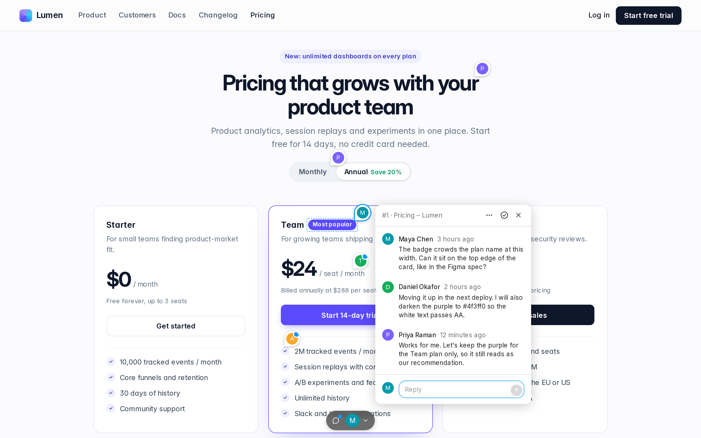
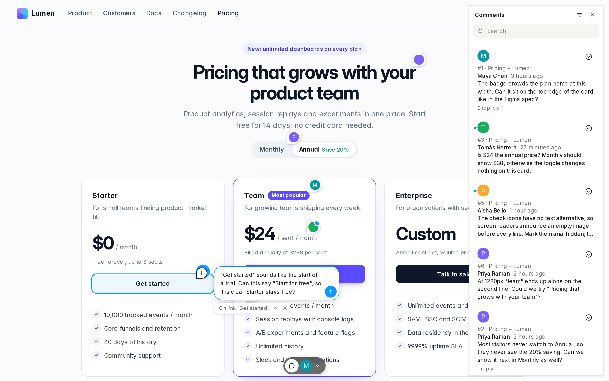
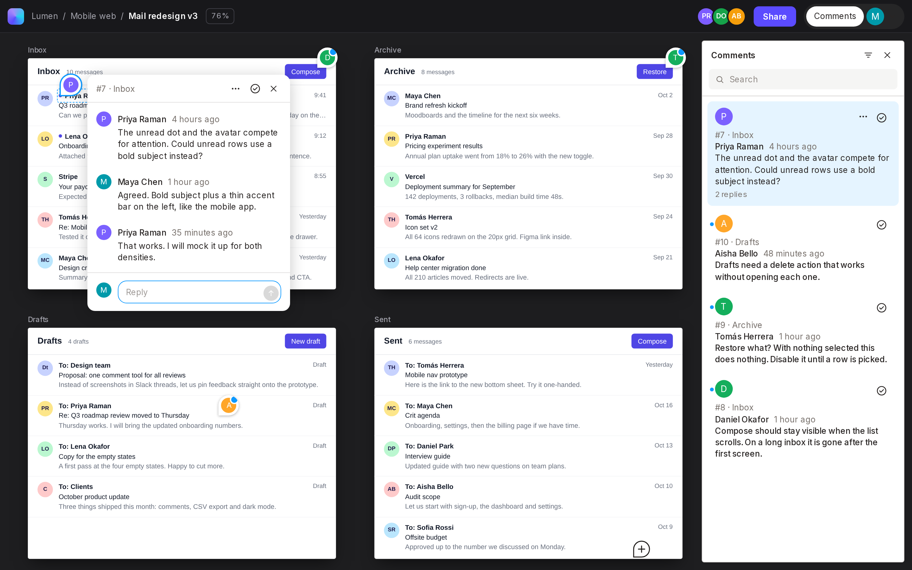

<p align="center">
  <a href="docs/MARKUP.md">Markup</a> ·
  <a href="docs/LIBRARY.md">Library</a> ·
  <a href="docs/SVELTEKIT.md">SvelteKit</a> ·
  <a href="docs/CODING-AGENTS.md">Coding agents</a> ·
  <a href="docs/DEPLOYMENT.md">Deployment</a> ·
  <a href="docs/ARCHITECTURE.md">Architecture</a>
</p>

visual-comments adds comments to any web page or app, like a design tool's
comments or Vercel's preview comments. People press **C**, click the element
they mean, and start a thread pinned to it. One self-hosted comment server
holds the threads of many sites; each site signs its own people in and passes
their comment requests on through its own server.

- Pins attach to elements, not coordinates, and follow them through scrolling,
  zooming, layout changes and same-origin iframes. A pin hides when its
  element is gone.
- Threads have replies, image attachments, resolve, unread markers and
  per-site numbers (#12), and update live.
- Works on any site with one `<script>` tag. `data-vc-*` attributes mark which
  parts take comments and let the page supply its own toggle, account button
  and thread panel.
- Uses the site's own sign-in: the site decides who can comment, and signing
  out of the site signs out of comments.
- One small Node and SQLite server for many sites, with a Dockerfile.
- The UI renders in a shadow root and is themed with `--vc-*` CSS variables.
  A Svelte 5 library lets apps react to threads, for example by zooming a
  canvas to one.
- A SvelteKit app turns comments on from environment variables, with a
  toolbar at the bottom of the window, and leaves them out of production
  builds ([SvelteKit](docs/SVELTEKIT.md)).
- Coding agents join a space with the `visual-comments` command, get every
  new comment, reply, and show what they are working on
  ([coding agents](docs/CODING-AGENTS.md)).

## Add comments to a site

A SvelteKit app has an adapter that does all of this, set up from
environment variables: see [SvelteKit](docs/SVELTEKIT.md).

1. **Add a proxy route to the site's server.** It passes `/_comments/*` on to
   the comment server with the space's secret and the signed-in person. With
   SvelteKit and [@convex-works/sign-in](https://git.convex.works/ConvexWorks/sign-in):

   ```ts
   // src/hooks.server.ts
   import { sequence } from '@sveltejs/kit/hooks';
   import { createSignIn } from '@convex-works/sign-in/server';
   import { commentsProxy } from 'visual-comments/server';

   const signIn = createSignIn({ issuer, clientId, clientSecret, secret });
   const comments = commentsProxy({
     server: 'https://comments.convex.works',
     space: 'my-team',
     secret: env.COMMENTS_SECRET            // the space's secret; never sent to browsers
   });

   export const handle = sequence(signIn.sveltekit(), comments.sveltekit());
   ```

   Other servers call `comments.handle(request, user)`; servers in other
   languages follow the [proxy protocol](docs/PROTOCOL.md).

2. **Add the script to the pages.**

   ```html
   <script src="https://comments.convex.works/v1/visual-comments.js" defer></script>
   ```

   On a page that shows other things, such as a canvas of frames, mark the
   parts that take comments with `data-vc-surface="id"` and name them with
   `data-vc-title`. Use `data-vc-toggle` for your own Comments button and
   `data-vc-panel` for where the thread list goes. See the
   [markup reference](docs/MARKUP.md), or the [library](docs/LIBRARY.md) for
   apps that need more.

3. **Press C** (or the speech-bubble button) and click an element.

## Quickstart

Requires Node 24 or later and pnpm 12.4.1. To run the comment server:

```sh
pnpm install
pnpm build
cp packages/server/spaces.example.json packages/server/spaces.json
# replace each "secret" in spaces.json with the output of: openssl rand -base64 32
pnpm -F @visual-comments/server start
```

It listens on port 4400 (`PORT`), stores threads in
`packages/server/data/comments.sqlite` (`DATABASE`), reads its spaces, one per
site with its own secret, from `packages/server/spaces.json` (`SPACES`), and
serves the script at `/v1/visual-comments.js`. See
[deployment](docs/DEPLOYMENT.md) for the spaces file and Docker.

To try it locally with an example site and development sign-in, run
`pnpm dev` and open `http://localhost:4401/auth/login?name=Maya&returnTo=/`.
It needs the sign-in repository checked out next to this one; the
[development guide](docs/DEVELOPMENT.md) covers the setup.

## Screenshots

A thread pinned to the plan badge on a pricing page:



Placing a new comment on a button, with the page's threads in the side panel:



A design canvas of iframe frames, where each frame takes its own comments:



## License

[MIT](LICENSE)
